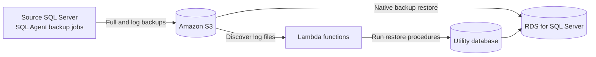

# RDS Log Shipping Demo

A SQL Server log shipping demo that copies database backups from a source SQL Server to Amazon S3, then restores them to an Amazon RDS for SQL Server target. Terraform provisions the AWS environment; SQL Server Agent jobs and Lambda functions move the restore process forward.

> **Demo project:** Review the security and operational settings before using this design with production data.

## How it works

- Source SQL Agent jobs run PowerShell scripts that sync backup files to S3.
- RDS uses its native SQL Server backup and restore integration with S3.
- Lambda functions find available transaction log backups and call procedures in the target `Utility` database.
- A target SQL Agent job runs the restore procedure on a schedule. CloudWatch Logs capture Lambda execution details.

## Repository map

| Path | Purpose |
| --- | --- |
| [`Setup/Source/`](Setup/Source/) | PowerShell S3 sync scripts and SQL Agent job definitions for the source server |
| [`Setup/Target/`](Setup/Target/) | SQL scripts for the restore login, Utility database, initial full restore, and target restore job |
| [`terraform/`](terraform/) | AWS infrastructure, RDS configuration, Lambda functions, and container build scripts |
| [`.github/workflows/`](.github/workflows/) | GitHub Actions workflows for fresh deployment, Terraform changes, and teardown |
| [`AWSSETUP.md`](AWSSETUP.md) | Detailed manual AWS setup guide using PowerShell and AWS CLI |

## Prerequisites

- A source SQL Server with SQL Server Agent enabled and a full recovery model database named `LSDemo`.
- AWS account credentials with permission to create the resources described in [AWSSETUP.md](AWSSETUP.md).
- Terraform 1.x, AWS CLI v2, Python, and Docker for local Terraform deployment (the Lambda images are built during apply).
- SSMS or `sqlcmd` access to the source and target SQL Server instances.
- For GitHub Actions deployment: repository secrets `AWS_ACCESS_KEY_ID`, `AWS_SECRET_ACCESS_KEY`, and `DB_PASSWORD`. The workflows target `us-east-1`.

## Deploy the AWS environment

Choose one deployment path:

1. **GitHub Actions:** configure the repository secrets above, then run **Deploy Terraform (Fresh Setup)** from the Actions tab for a new environment. The workflow plans the changes and pauses for manual approval before applying. **Deploy Terraform Changes** runs on pushes to `main` and can also be started manually.
2. **Manual setup:** follow [AWSSETUP.md](AWSSETUP.md) for the AWS CLI and PowerShell procedure.
3. **Local Terraform:** from `terraform/`, configure AWS credentials and provide the required administrator password as a Terraform variable, then run `terraform init`, `terraform plan`, and `terraform apply`. For example, use a local `terraform.tfvars` file (ignored by Git) containing `db_password = "<strong-password>"`.

Deployment creates an RDS SQL Server instance, an S3 bucket, IAM roles and users, Lambda functions and their ECR images, and supporting network and logging resources. Record the RDS endpoint, bucket name, and `s3_backup_user` name from Terraform outputs for the setup below.

> **State and teardown:** the GitHub workflows store Terraform state in the repository. Protect repository access and state accordingly. The **Destroy Terraform Environment** workflow tears down the demo resources; confirm the workflow and its plan before running it.

## Configure the source SQL Server

1. Copy [`Setup/Source/Scripts/`](Setup/Source/Scripts/) to the source server (the supplied job scripts expect `C:\SQL2022\Scripts\`).
2. Update `SyncToS3_Full.ps1` and `SyncToS3_Log.ps1` with the deployed S3 bucket prefixes and the source backup folder paths.
3. Configure AWS CLI credentials for the Windows account that runs SQL Server Agent. The scripts contain placeholder credential lines; use an appropriate credential mechanism and do not commit real access keys.
4. Run [`Setup/Source/Jobs/Sync Jobs.sql`](Setup/Source/Jobs/Sync%20Jobs.sql) against `msdb` to create the full and log sync jobs. Review and adjust their schedules and paths for your environment.
5. Confirm the source database is named `LSDemo` and is configured for transaction log backups.

The scripts sync to `backups/LSDemo/Full/` and `backups/LSDemo/Log/`. The log sync script uses `--delete`, so files removed from the local log backup directory are also removed from the S3 log prefix.

## Configure the RDS target

Connect to the RDS instance using the administrator credentials supplied at deployment, then run these scripts in order:

1. [`CreateLogin.sql`](Setup/Target/CreateLogin.sql) creates the `log_ship_restore_user` login.
2. [`UtilityDatabase.sql`](Setup/Target/UtilityDatabase.sql) creates the `Utility` database, restore procedures, and monitoring procedure.
3. Run the source full backup sync job and wait for its backup to appear in S3. In [`Target_RestoreFullBackup.sql`](Setup/Target/Target_RestoreFullBackup.sql), set `@S3_arn_to_restore_from` to that backup's S3 ARN, then run the script on RDS. The restore uses `NORECOVERY` so subsequent log backups can be applied.
4. [`LogShippingRestoreJob.sql`](Setup/Target/LogShippingRestoreJob.sql) creates the SQL Agent job that applies log backups on the target.

The supplied target job runs every five minutes. Change the schedule if that interval does not suit your demo.

## Monitoring

- On the target, query `Utility.dbo.Monitor_RDS_Logship` to review restore history and status.
- For failures, inspect the relevant Lambda log group in CloudWatch and the SQL Server Agent job history on the source or target.

## Configuration notes

- Terraform defaults to AWS region `us-east-1`, SQL administrator `admin`, restore login `log_ship_restore_user`, and database `LSDemo`.
- `db_password` is required. `db_restore_password` is optional and defaults to the administrator password when omitted.
- Restrict `allowed_cidr_blocks` to trusted client addresses before deployment; its current Terraform default permits access from `0.0.0.0/0`.
- Keep passwords and AWS access keys out of source control. Terraform variable files (`*.tfvars`) are ignored by Git.

For the full manual resource-by-resource walkthrough, see [AWSSETUP.md](AWSSETUP.md).
